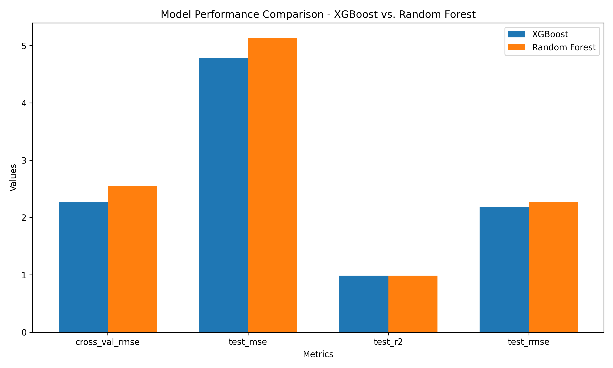
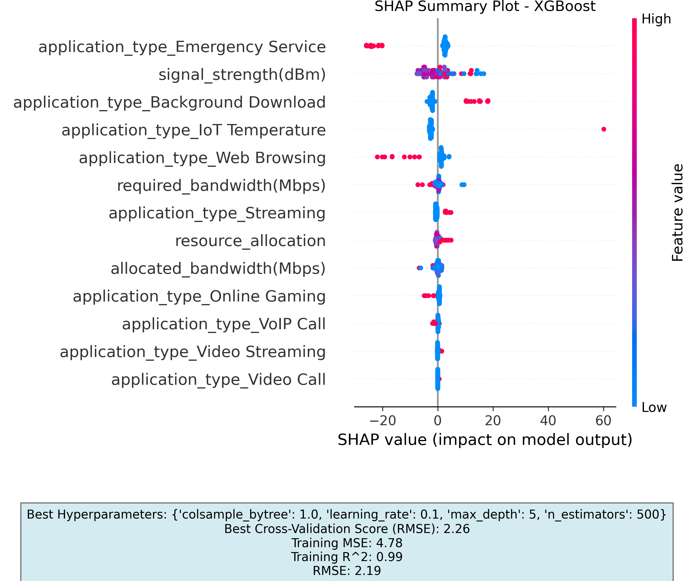
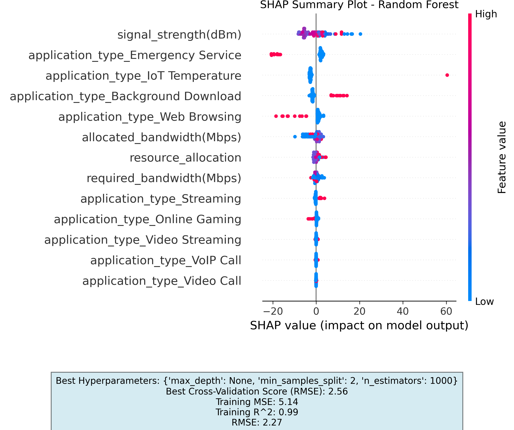

# 📡 5G QoS Predictive Modeler & Explainability (XAI) Pipeline

[](https://www.python.org/)
[](https://scikit-learn.org/)
[](https://xgboost.readthedocs.io/)
[](https://shap.readthedocs.io/)
[](https://www.mysql.com/)
[](.github/workflows/clean.yml)
[](LICENSE)

An end-to-end Machine Learning and Explainable AI (XAI) pipeline designed to forecast **Quality of Service (QoS)** metrics and **Resource Allocation** in 5G cellular networks. The system benchmarks **XGBoost**, **Random Forest**, and **MLP** regressors while leveraging **SHAP (SHapley Additive exPlanations)** to interpret model predictions and satisfy telecommunication SLA transparency requirements.

---

## 🌟 Key Features

- **5G Telemetry Ingestion & Exploration:** Automated loading and type-casting of QoS network slices (application type, signal strength in dBm, latency in msec, required vs. allocated bandwidth in Mbps, resource allocation).
- **Supervised Regression Benchmarking:** Comparative training of **XGBoost Regressor**, **Random Forest Regressor**, and **MLP Regressor** with cross-validation and hyperparameter optimization.
- **Explainable AI (XAI) with SHAP:** Feature attribution via SHAP Summary Plots, Bar Charts, and Waterfall plots to unmask the impact of signal strength and latency on resource allocation decisions.
- **Persistent Telemetry & Metric Storage:** Direct MySQL integration saving performance evaluations ($R^2$, RMSE, MSE, MAPE) and run artifacts into relational tables.
- **Automated Visualization Engine:** Standalone visualization scripts generating high-resolution comparative diagnostic histograms and distribution curves.
- **Production-Ready Engineering Standards:** Configured with Pre-commit hooks (`flake8`, `black`, `isort`), `tox` environments, and GitHub Actions CI workflow.

---

## 📊 Model Evaluation & Explainability

### 1. Performance Benchmark (XGBoost vs. Random Forest)
Both models are quantitatively evaluated on held-out test splits across multiple regression metrics:



### 2. SHAP Feature Attribution (Interpretability)
SHAP summary plots identify the exact contribution and magnitude of each network feature towards 5G resource allocation decisions:

| Feature Importance (XGBoost) | Feature Importance (Random Forest) |
| :---: | :---: |
|  |  |

---

## 🏗️ Project Architecture & Directory Layout

```plaintext
5g-qos-predictive-modeler/
├── .github/workflows/      # Automated CI workflow (clean.yml)
├── config/                 # Configuration files & parameters
├── data/                   # 5G QoS dataset CSV & schema storage
├── docs/                   # Technical reports & documentation
├── graphs/                 # Exported SHAP plots, metrics, & histograms
├── helpers/                # Reusable utility modules
├── scripts/
│   ├── main.py             # Pipeline execution (data, training, SHAP, DB)
│   ├── Data Visualization.py # Graph generation from stored DB runs
├── .env-template           # Template for environment credentials
├── .gitignore              # Production-grade Python gitignore
├── .pre-commit-config.yaml # Linting & formatting configurations
├── Pipfile                 # Pipenv dependency management
├── requirements.txt        # Standard pip dependencies
├── setup.py                # Package setup script
└── tox.ini                 # Multi-environment testing configuration
```

---

## 🚀 Quick Start

### 1. Clone the Repository
```bash
git clone https://github.com/Mamel11/5g-qos-predictive-modeler.git
cd 5g-qos-predictive-modeler
```

### 2. Set Up Virtual Environment
```bash
# Using standard Python venv
python -m venv .venv

# Activate environment
# On Windows:
.venv\Scripts\activate
# On Linux / macOS:
source .venv/bin/activate
```

### 3. Install Dependencies
```bash
pip install -r requirements.txt
```

### 4. Database Configuration (Optional)
Configure your MySQL database parameters or review `.env-template`:
```bash
cp .env-template .env
```

### 5. Run the Pipeline
```bash
# Execute training, evaluation, SHAP analysis & database logging
python scripts/main.py

# Generate comparison plots from stored runs
python "scripts/Data Visualization.py"
```

All generated plots will be automatically exported to the `graphs/` directory.

---

## 🛠️ Code Quality & Pre-commit
To enforce clean code practices and PEP8 styling before committing:
```bash
pre-commit install
pre-commit run --all-files
```

---

## 📜 Authors & Acknowledgments

- **Emmanouela Xenou** ([@Mamel11](https://github.com/Mamel11)) - *Computer Engineering & Informatics (CEID), University of Patras*
- **Stefanos Metzidakis** - *Project Co-author*

---

## 📄 License
This project is open-source and available under the [MIT License](LICENSE).
